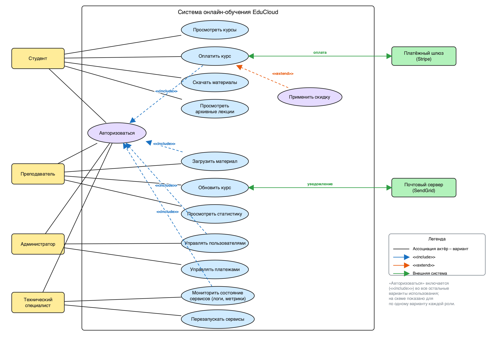
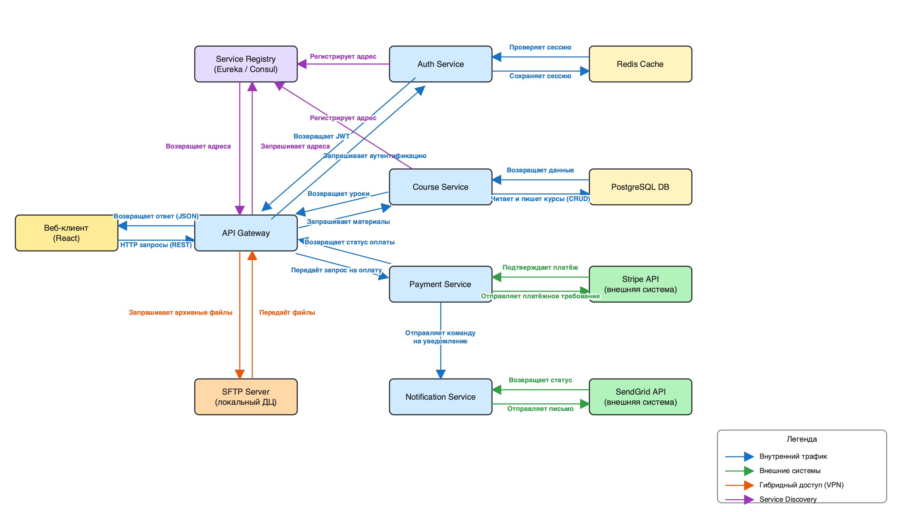
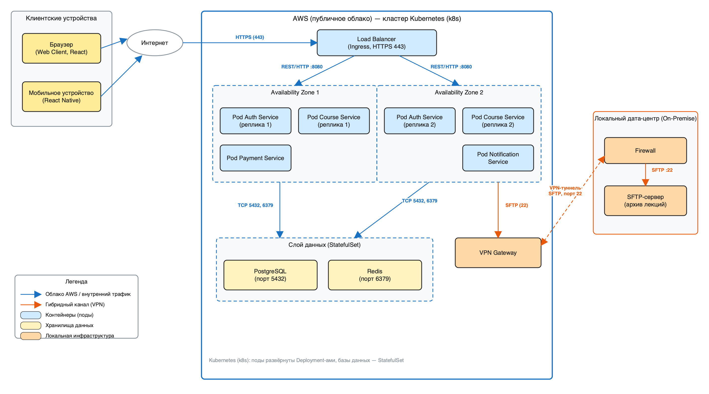

# Лабораторная работа №1. Архитектура облачных, распределённых, микросервисных и гибридных ИС

Студенты: Рудометкин Станислав Владимирович, Татенко Мария Станиславовна, группа 22-к-кб1, вариант 19.

Сквозной сценарий — платформа онлайн-обучения **EduCloud**. Построены три диаграммы;
доработки из раздела 4 уже включены в итоговые версии.

| Диаграмма | Файл Excalidraw | Изображение |
|---|---|---|
| Use Case | `diagrams/1_use_case.excalidraw` | `diagrams/1_use_case.png` / `.svg` |
| DFD | `diagrams/2_dfd.excalidraw` | `diagrams/2_dfd.png` / `.svg` |
| Deployment | `diagrams/3_deployment.excalidraw` | `diagrams/3_deployment.png` / `.svg` |

Файлы `.excalidraw` открываются на https://excalidraw.com (Open → выбрать файл), их
можно редактировать. Диаграммы построены скриптом `generate_diagrams.py`
(`python generate_diagrams.py`, нужен пакет `cairosvg` для PNG).

## Этап 1. Use Case

Границы системы — прямоугольник «Система онлайн-обучения EduCloud». Актёры: Студент,
Преподаватель, Администратор и (задание 1) Технический специалист; внешние актёры
вне границы — Платёжный шлюз (Stripe) и Почтовый сервер (SendGrid).
«Авторизоваться» связан отношением `<<include>>` с вариантами использования каждой
роли (на схеме показано по одному примеру на роль); «Применить скидку» расширяет
«Оплатить курс» отношением `<<extend>>`.

## Этап 2. DFD

Диаграмма первого уровня (уровень микросервисов). Потоки двунаправленные и подписаны
глаголами. Цвета: синий — внутренний трафик, зелёный — внешние системы, оранжевый —
гибридный доступ к SFTP, фиолетовый — Service Discovery. По заданию 2 добавлен Service
Registry: Auth Service и Course Service регистрируют в нём свои адреса, API Gateway
запрашивает у него адреса сервисов.

## Этап 3. Deployment

Три узла: клиентские устройства, кластер Kubernetes в AWS и локальный дата-центр.
По заданию 3 облако разделено на две зоны доступности; в каждой по одной реплике Auth
Service и Course Service, перед ними Load Balancer. Базы данных развёрнуты как
StatefulSet, связь с локальным ДЦ идёт через VPN-туннель и Firewall (SFTP, порт 22).

## Ответы на контрольные вопросы

1. **Use Case: микросервисы и монолит.** Для пользователя система выглядит одинаково,
   но граница системы объединяет множество независимых сервисов: один вариант
   использования (например, «Оплатить курс») реализуется цепочкой вызовов нескольких
   сервисов. Внешние системы (Stripe, SendGrid) остаются за границей, а внутренние
   сервисы на Use Case не показывают.
2. **Уровень DFD.** Диаграмма первого уровня детализации: система разложена на
   микросервисы, хранилища и внешние сущности. Контекстной диаграммы недостаточно —
   на ней не видно сервисов, а детализация внутри сервисов избыточна для целей работы.
3. **Асинхронное взаимодействие.** Через очередь рисуют отдельный блок «Message Queue
   (RabbitMQ)»: отправитель стрелкой публикует сообщение в очередь, подписчик получает
   его другой стрелкой; стрелки делают пунктирными и подписывают «publish» и «consume».
   Прямой стрелки между сервисами нет.
4. **Гибридная среда и безопасность.** На диаграмме показаны VPN-туннель между AWS и
   локальным ДЦ, Firewall перед SFTP-сервером, ограничение протокола и порта (только
   SFTP, 22) и отсутствие прямого доступа клиентов к ДЦ.
5. **Stateful и stateless.** Stateful: PostgreSQL, Redis, SFTP-сервер. Stateless:
   микросервисы, API Gateway, Load Balancer. Stateless-сервисы масштабируются добавлением
   реплик за балансировщиком; stateful требуют репликации, резервного копирования и
   StatefulSet с постоянными томами.
6. **Поды вместо виртуальных машин.** В Kubernetes единица развёртывания — под
   (контейнеры), а узлы-ВМ скрыты за оркестратором: он сам размещает, перезапускает и
   масштабирует поды. Поэтому на диаграмме указывают поды и кластер, а не серверы.
7. **Service Registry и потоки.** Gateway перестаёт хранить адреса сервисов статически:
   перед запросом он спрашивает адрес в реестре, а сервисы при старте регистрируют адрес
   сами. Основные потоки данных идут по-прежнему между Gateway и сервисами, добавляется
   служебный поток Service Discovery.
